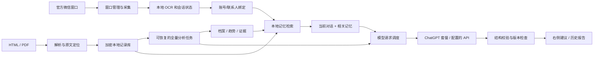

# Windows ChatAssistant 完整版设计

日期：2026-10-17。基于 `feat/windows-lite` 的 0.2 本地源码。状态：设计完成、待实施；本文不代表下述功能已经完成或验收通过。

实施入口：[分任务实施计划](WINDOWS_LITE_COMPLETION_PLAN_2026-10-17.md)。当前事实以 [0.2 本机验证记录](WINDOWS_LITE_VERIFICATION_2026-10-17.md) 为准。

## 1. 目标与完成定义

交付一个 Windows 安装包：用户打开自己的官方微信后，助手自动发现并把聊天窗口停靠在中央；聊天产生变化时自动识别、结合这个联系人的历史记忆生成右侧建议；在独立历史页导入 HTML/PDF，查看完整原文、客户档案、交流趋势和统计。用户负责登录微信、账号授权和最终发送消息。

沿用已认可的界面：左侧聊天/历史/设置导航，中央微信，右侧可展开的 AI 建议。连接、路径、账号和模型选项归设置。实时聊天不恢复手动分析、校正文案或自建批注工具。

三个完成门槛：

1. 功能闭环：真实微信新文字 → 正确会话 → 当前联系人记忆 → 模型完成事件 → 当前会话建议，切换会话后不会显示或复制旧结果。
2. 历史闭环：导入 → 可定位原文 → 全量分批处理 → 有来源的档案/趋势 → 实时检索引用；报告显示处理范围和缺失项。
3. 交付闭环：无 Python 的干净 Windows 环境完成安装、启动、升级、卸载及数据保留验证；安装包可追溯到构建源码。

## 2. 当前基线与真实差距

| 模块 | 已有实现/证据 | 本次需要补齐 |
| --- | --- | --- |
| 微信窗口 | 完整 exe 路径发现，原生顶层停靠，WGC 画面和 11 条可见消息 OCR 实测 | 焦点、弹窗、DPI、多窗口、重启恢复和交互验收 |
| 实时建议 | `ui.py` 自动调用当前 `editor` 文字，已有 revision 过期保护 | 可取消任务、统一队列、完整端到端验收、历史记忆输入 |
| ChatGPT | 一次官方授权、7 个模型、合成对话返回 3 条建议 | 账号注册隔离、退出撤销、刷新竞态、错误恢复和安装版完整流程 |
| 历史库 | DPAPI 加密片段、分页浏览、搜索、离线统计 | 消息结构、证据位置、全量模型分析、档案及趋势、实时关联 |
| 历史上下文 | `history.py:build_context` 最多末尾 500 片段/8000 字 | 全量分析不能沿用这个截取函数；实时检索也不能只取末尾 |
| 数据隔离 | 联系人列表按账号字符串摘要过滤 | 所有单项读写必须同时验证账号和联系人范围 |
| 打包 | PyInstaller + Inno Setup，清缓存构建，portable smoke 通过 | 正式安装生命周期、构建清单、独立环境验证、发布产物 |

旧文档中的 Nuitka 构建阻塞和“尚无安装包”等描述属于历史状态，不能作为本轮起点。

## 3. 技术路线选择

保留 Python 3.12、PySide6、Win32、Windows Graphics Capture、本地 OCR、SQLite 和 DPAPI，不重写整个桌面壳。

| 微信展示路线 | 判断 |
| --- | --- |
| `SetParent` 真正改成子窗口 | 旧探针已出现单击/滚轮故障，暂不采用。Microsoft 文档也说明跨 DPI awareness 重设父窗口存在异常或进程 DPI 重置风险。 |
| 原生顶层窗口中央停靠 | 继续完善，作为默认路线。微信仍自行处理输入法、扫码和弹窗，助手管理位置与生命周期。 |
| 图像镜像 + 独立微信 | 作为清楚标识的兼容回退；镜像不冒充可交互聊天控件。 |

这是在现有实测和系统约束下的工程选择，并非微信官方提供了嵌入 SDK。[Microsoft SetParent 文档](https://learn.microsoft.com/en-us/windows/win32/api/winuser/nf-winuser-setparent)。

中央停靠不能承诺让官方微信变成普通 Qt 子控件，也不能保证隐藏所有微信任务栏入口。真正最小化时暂停实时采集，历史分析可以继续。对于被其他窗口遮挡但未最小化的微信，能否稳定取得新画面由兼容性实测决定；不得用旧帧维持“正在实时分析”的假状态。

## 4. 模块与数据流

主线程只负责 Qt 界面。窗口采集、本地 OCR、文件解析、数据库批处理和模型调用不阻塞主线程。一个应用实例拥有设置写入和模型调度；其他启动实例激活既有窗口，避免两个进程同时刷新同一令牌。

`ui.py` 保留页面组装和事件绑定，把协调逻辑逐步抽到 `realtime.py`、`window_manager.py`、`inference.py`、`account_store.py`。提取随对应功能完成，避免一次大范围搬动。

## 5. 微信停靠与实时识别

### 5.1 窗口生命周期

窗口身份由规范化 exe 路径、PID、进程启动时刻、HWND 共同组成，每次采集和操作前验证；PID/HWND 只属于当前运行实例，不能当微信账号永久 ID。

- 只有一个可信候选时自动连接；多个窗口时显示用户命名的账号标签。
- 区分登录窗、聊天主窗、弹窗；登录完成后允许同一可信进程的新主窗口接替，不能把图片预览窗当主窗口。
- 移动、缩放、跨屏或 DPI 变化时统一换算坐标。暂停持续位置修正，直到用户拖动或原生弹窗操作完成，避免抢焦点。
- 2026-10-17 用户截图显示中央区域露出其他桌面窗口：当前 `sync_dock` 会从 Qt 窗口 mask 中扣掉聊天开口，而 `WindowDock.align` 仅在矩形变化时更新 Z-order；现有测试替身也确认位置不变时不会修正层级。后续必须分别校验几何和层级：助手/微信窗口组激活时修复正确顺序，其他应用在前台时不抢焦点或强制全局置顶。层级未确认时关闭透明开口并显示来自所选 HWND 的只读画面，不能露出不相关桌面内容。
- 聊天页显示时同步中央位置；切设置/历史或最小化助手时，默认只隐藏/最小化助手管理的活动微信，恢复时还原。
- 记录接管前位置、显示状态及是否由助手最小化。退出后还原；不得恢复用户原本已最小化且未接管的其他微信。
- 采用小型恢复守护进程：只持有已验证窗口身份和原始几何，不接触聊天；主程序异常退出时尝试还原仍属同一进程的窗口。
- 弹窗保持原生顶层关系。检测到弹窗覆盖聊天采集区域时，将快照标记不可用，不分析弹窗文字。

### 5.2 采集与分析状态

状态包括 `disconnected / connecting / login / live / minimized / stale / popup / error`。区分采集器心跳、最近新帧、最近内容变化和最近 OCR 时间。静止画面没有变化不等于故障；未经确认的新鲜画面也不能被当作新消息。

保留当前 2 秒稳定等待、同一来源至少 10 秒请求间隔，作为第一轮可调默认值。只保留每个来源最新待处理帧；两条连续相同正文仍是两个消息，不能仅按文本集合去重。

每个分析任务冻结 `AnalysisKey`：来源实例、会话 epoch、快照摘要、绑定版本、记忆版本、模型配置版本。任一项变化后，旧结果失效且复制按钮停用。关闭或切换会话发出取消信号，关闭本地流连接；取消不声称撤回已经发送的请求或用量。

### 5.3 多开与后台边界

支持用户已启动的多个官方微信窗口，不修改互斥体或注入进程强制多开。第一目标验收 2 个账号，默认最多同时管理 3 个来源；更多来源进入未监控列表。

每个来源独立状态、账号标签和建议。只有活动来源在中央停靠；其他来源可以保持独立正常窗口。后台监控仅在该来源有有效新帧时运行；最小化来源明确暂停。切换设置提供“后台监控其他正常窗口”开关，默认关闭，开启后不再自动最小化这些来源。

监控范围始终是每个微信窗口当前打开的会话。不会自动切换所有联系人、滚动抓取全部历史或在最小化状态声称持续读取新消息。

### 5.4 实现补充（2026-10-18，T4）

- `window_manager.py` 统一停靠/视图（chat/settings/history/minimized）/健康状态与恢复记录；物理↔DIP 往返误差 ≤2px；弹窗出现时暂停停靠并只读回退；仅在本助手为激活组时修复 Z 序，不循环抢焦点、不 SetParent；登录窗口→主窗口同进程可信接替。
- `recovery_guard.py` 用 HMAC 签名恢复记录 + 独立守护子进程：主程序异常退出后先验证 exe/PID/启动时刻/HWND 再恢复；正常退出只清理不恢复；原微信关闭/HWND 复用零操作。
- `discovery.py` 增加 valid_source/classify_window/popup/zorder/foreground/source_kind 与 discover 的 kind/dpi；`window_dock.py` 句柄复用拒绝、2px 容差回滚、弹窗暂停、用户拖动不抢、detach 恢复几何+最小化；`worker.py` 上报 popup/minimized；`main.py` 守护生命周期与 `--recovery-guard` 分流。
- UI 已接入 WindowManager（T4-UI，commit `403c526`）：页面切换 set_view、健康状态关开口只读回退、tick 新鲜度、断开/关闭 detach；R-07 的 after=0 与无效 host/aperture 已 fail-closed。真实输入法/扫码/多开/真实弹窗留 T12。

## 6. ChatGPT 授权、模型和请求队列

### 6.1 账号模型

将一个 `subscription` 升级为独立注册记录集合，字段包括 `registration_id`、验证后的 subject/client 映射、加密凭据、权限状态和模型目录。微信账号与 ChatGPT 账号是两种独立标识，不相互推导。

设置页提供：继续使用 ChatGPT、新增账号、切换账号、重新授权、退出当前账号、刷新模型、查看官方用量。旧单账号配置迁移为第一条记录，保留原 client/host 映射。

授权等待可取消，15 分钟倒计时仅属于当前事务；只接纳匹配当前 state 的回调，过期浏览器回调不能终止新的授权。收到回调后完成令牌交换和身份校验，再显示“连接成功”。

刷新由账号服务串行执行，所有任务取当前凭据而非保存各自旧副本；设置写入采用单写入者和原子替换。退出账号先停止相关请求，尝试撤销会话，再清除本地令牌。临时网络错误保留凭据，明确失效才进入重新授权。[官方账号与会话要求](https://developers.openai.com/siwc/token-sharing-open-source/profiles-and-sessions)。

### 6.2 与 Codex 的关系

产品承诺改为“使用授权 ChatGPT 账号可用的模型与套餐权限”。模型列表从该账号官方目录获取；不复制 Codex 桌面当前选中的模型，不读取它的本地凭据。目录变化后保留用户选择；所选模型不再可用时暂停并提示重新选择，不静默切换。

用量页显示本应用已知的请求次数、任务进度以及服务返回的限制状态，并链接官方 Usage；没有官方数据时显示未知，不推算 Codex 剩余额度百分比或重置时刻。[官方模型目录](https://developers.openai.com/siwc/token-sharing-open-source/models-and-inference)。

#### 6.2.1 实现补充（2026-10-18，T0a/T0b）

- 读取与分析后端各自记忆模型：`reading_model`、`chatgpt_model`、`api_model`、`local_model`、`codex_model` 分字段持久化；应用重启、后端来回切换后自动恢复，不共用单个 `model` 字段。ChatGPT 授权与模型目录持久保存，只有授权失效、被撤销或用户手动断开时才提示重新连接。
- 兼容/本地 API 配置增加厂商预设（DeepSeek 官方 / OpenRouter / 通义兼容 / 本地 Ollama / 自定义），选择后填入地址、仍可手改；输入地址与 Key 后通过 `GET {base}/models` 读取模型列表并下拉选择，读取结果不落日志。
- 设置页与聊天页显示“当前分析：<后端> / <模型>”，分析卡片内提供保存入口；ChatGPT 显示已连接账号状态与「断开授权」（只清除该授权，保留其它配置）。T2 的多账号注册生命周期在此之上扩展。

#### 6.2.2 账号服务实现补充（2026-10-18，T2 后端）

- 新增 `account_store.py`：多注册记录（registration_id + host_id/client_id/subject 映射）、DPAPI 加密凭据、单调 revision；写入临时文件 + `os.replace` 原子保存；刷新在锁内重读唯一权威记录并单飞，`save_refreshed` 用 expected_revision CAS 防止旧快照写回旧令牌。
- `settings.py` 改为账号服务是唯一凭据写者；`subscription.py` 的 `access_token/list_models` 路由账号服务，`sign_in` 保留兼容；旧单账号配置迁移保 client_id/host_id。
- 权限状态区分 connected / login_only / reauth_required；临时网络错误保留凭据，明确失效清令牌但保留注册映射；退出只影响所选注册并区分已撤销/仅本地退出。
- **设置 UI 多账号交互尚未集成**（Lead 负责），T12 需完成一次真实安装版授权验收。

### 6.3 通用模型层

把现有专门输出三条建议的 `analyze` 拆成通用流式传输和三种任务 schema：`realtime_reply`、`history_extract`、`history_reduce`。完成事件和结构校验同时通过才提交结果；历史分析不能复用“三条回复”的校验器。

首版全应用只允许 1 个模型请求进行中。实时任务优先，历史任务每完成一批让出队列；同来源待发任务只保留最新版本，多来源实时任务轮转，历史任务最多连续让出 5 次后安排一批，防止饥饿。

连接超时 10 秒、无数据超时 30 秒；总超时实时 120 秒、历史单批 180 秒，均有取消。网络暂时不可用和 503 采用有限退避；额度受限时暂停队列，授权终止时停止该注册的任务。错误码、请求 ID、阶段与耗时可以进入诊断，正文、提示词、令牌和完整回调 URL 不进入诊断。[官方错误恢复](https://developers.openai.com/siwc/token-sharing-open-source/errors-and-recovery)。

ChatGPT 路由继续使用 Responses HTTP 流、`store:false`、`stream:true`，上下文由应用本地管理；不依赖托管 file search、Files 上传接口或服务端后台任务。历史文件先在本机解析，再按任务范围发送文字。[官方当前接口限制](https://developers.openai.com/siwc/token-sharing-open-source/preview-limitations)。

## 7. 历史记录与记忆库

### 7.1 数据范围与迁移

新增不可变 `ScopeKey(wechat_account_id, person_id)`，所有读、写、检索、导入、报告、删除都必须接收它并在数据库验证归属。显示名称可改，稳定 ID 不变。旧账号字符串摘要迁移为本地账号档案，旧片段保留为 `fragment`，不伪造为标准消息。

#### 7.1.1 实现补充（2026-10-18，T5）

- V2 库六表：`wechat_accounts / people / sources / records / scope_state / derived_memory`，`PRAGMA user_version=2`；所有公开持久方法强制 `ScopeKey` 并在 SQL 中校验联系人/账号归属，跨 scope 的 person/source/record 读写删一律 `ScopeMismatchError`。
- 版本语义：`source_set_version` 与 `memory_version` 在导入/修订/删除时递增；`iter_records(scope, source_version)` 版本不符抛 `StaleSourceVersionError`（fail-closed）；`snapshot(scope)` 冻结来源 ID、版本与 `EvidenceRef` 范围；`delete_source` 同时失效该范围派生记忆。
- 0.2 迁移：只读校验旧库 → SQLite backup API 受控备份并校验 → 单事务校验数量/顺序/摘要后建 V2 表，旧片段保留 `fragment`；任一步失败回滚且旧库字节不变；未知/更高 schema 版本拒绝写入。
- UI 调用方只做 T5 最小适配（联系人 userData 用 `ScopeKey`、stats dataclass）；导入任务与进度 UI 由 T6 的 `importers + ImportJobs` 替换。

| 数据对象 | 关键字段/用途 |
| --- | --- |
| `wechat_accounts` | UUID、加密标签、旧账号映射；不冒称获取到了微信内部账号 ID |
| `people` | UUID、所属账号、加密显示名、人工关联信息 |
| `sources` | 所属范围、文件摘要、格式/解析器版本、导入版本、页数/记录数/失败数 |
| `records` | 稳定 record_id、source_id、原始顺序、类型、可空发送人/时间、加密正文、原文定位、质量标记 |
| `analysis_jobs / batches` | 固定输入版本、模型/提示词版本、批次范围、状态、重试次数、成功覆盖范围 |
| `memory_items` | 事实/推断/待确认分类、证据引用、时间范围、冲突状态、来源版本 |
| `reports` | 输入版本、覆盖率、摘要、趋势、确定性统计、生成时间 |

正文、联系人、文件名、原文定位、报告和索引载荷均加密；关系 ID、计数及必要版本字段可明文。首版不建立明文 FTS 或云向量库；检索索引仅在当前范围的内存中解密构建。离开范围后释放缓存。

数据库采用 `PRAGMA user_version` 迁移；迁移前生成同用户可解密的备份，事务完成后校验记录数。旧应用发现更高 schema 时停止写入；回滚需恢复匹配版本备份，不能用旧 EXE 直接写新库。

版本约定：`source_set_version` 在导入、删除或修订原文时递增，API 的 `source_version` 指它；`memory_version` 在原文集合或已发布档案/记忆变化时递增。实时任务同时固定当前输入与 memory_version，不能只检查文件是否变化而漏掉新报告。

### 7.2 导入流程

当前微信会话 → 历史页自动带出当前联系人 → 导入 PDF/HTML → 展示导入条数、时间范围和质量提示 → 保存并生成本地统计。若当前会话尚未绑定档案，首次导入给出联系人候选并让用户确认一次；自动创建档案时仍使用独立 UUID，不按名称合并。账号档案选择放设置，历史主界面不要求填写“默认微信账号”或先手动新建联系人。

历史页主入口显示“当前联系人：田子夜（示例）”及“导入聊天记录”。“选择其他联系人”作为次要入口，用于查看既有档案或没有连接微信时独立导入。只有当前已确认的会话才用于自动预选，OCR 未确认或同名绑定不确定时不沿用旧联系人。当前代码的 `show_history` 只刷新列表，没有传递当前聊天上下文，本次需求应在 T8/T9 联动完成。

历史 AI 分析是独立任务动作；首次明确告知所选记录将发送到所选模型，用户可对该档案开启后续自动增量分析。

采用解析器注册表：有实际样本的 ExportWeChat 版本使用专用适配器；未知 HTML 使用安全纯文本回退并标为片段。尚未提供真实 ExportWeChat 样本，专用适配器的准确性属于外部依赖，不能仅凭名称猜 DOM。

HTML 不执行脚本、不取远程资源、不自动打开附件。PDF 保留页号和页内顺序；文字页直接提取，扫描页增加可选本地渲染/OCR 队列，显示页级进度和识别质量。扫描件不能保证恢复微信原始发送时间与发言人；不确定字段保留空值。单文件上限延续 100 MB；超大任务分页处理，可取消后保留完整提交的批次。

同一范围内按文件摘要阻止重复导入；不同文件的重叠记录先标记候选，不仅凭正文删除。只有可靠的导出消息 ID 或明确的序列/时间/发送人证据才能确认跨文件重复。统计应显示是否存在重叠来源。

### 7.2.1 实现补充（2026-10-18，T6）

- 新增 `importers/{base,html_generic,exportwechat_html,pdf}.py` 与 `import_jobs.py`：HTML 纯文本解析（UTF-8/UTF-16/GB18030、不执行脚本/不请求远程、30s/100MB/行数上限、取消）；PDF 用 pypdfium2 受控子进程（150 DPI、每页 ≤1200 万像素、页级 30s 超时记录 issue 后下一页重启续传 ordinal），仅无文字页走本地 OCR，原图只在内存不落盘，损坏/密码页给页级问题；ExportWeChat 目前只做签名探测 + 通用回退，无真实样本时 `SAMPLE_VERIFIED=False`，不标“精确支持”。
- `history_ui.py` 接入最小导入任务 UI（后台导入、取消、“扫描页本地 OCR”、进度与页级问题）；`requirements.txt` 固定 `pypdfium2>=5.14,<6`，PDFium 许可与 version.json 入 `licenses/pypdfium2/`。frozen 打包需 T11 在 `main.py` 分发 `--lite-pdf-worker`（已由 `617a89f` 完成）；超时页重试由 P2 `4cb2268` 提供后端入口（UI 按钮与真实扫描 PDF 验收留 T12）。

### 7.3 全量模型分析

任务开始冻结 source_set_version。先确定性遍历全部记录并计算统计，再按顺序分批提取事实、需求、承诺、分歧和变化，最后分层合并为档案及趋势。

- 单批正文默认最多 12288 UTF-8 字节；上下文重叠最多 2 条记录且不超过 2048 字节。单条过长时按字符边界分段，保留原记录偏移。
- 每次请求总输入默认不超过 32768 UTF-8 字节；这是应用自定保守上限，不是模型 token 数声明。触发上下文限制时缩小批次，不能静默丢记录。
- 批次输出必须引用本批允许的 record_id/字符范围。不存在、跨联系人或越界引用拒收；结论中无证据的内容不进入事实库。
- 汇总采用分层合并，不把无限增长的全部批次摘要拼成一次请求。批次状态持久化，崩溃后从未完成批次继续。
- 覆盖率按输入字符范围的并集和记录数双重计算，重叠不重复计数；只有全部非空输入范围成功处理才显示 100%。解析失败页、附件未识别与导出缺失另列，不能被 100% 掩盖。
- 100% 表示全部已提取输入都完成了批次处理，不代表模型理解无遗漏，也不代表文件包含了对方全部真实聊天历史；报告仍显示来源、解析质量和待确认项。
- 新文件只分析新增/受影响批次；模型或提示词版本变化产生新分析版本。删除来源立即提高记忆版本，使相关报告、索引及正在生成的建议失效。

用户看到的档案包括：明确表达的需求与偏好、已承诺事项、未解决问题、沟通方式和可核对的时间线。关系趋势展示话题/互动频率/阶段变化以及原文依据；发送人和时间字段不足时不计算回复时延或双方主动比例。模型倾向解释标为推断，不做没有证据的心理或人格定性。

#### 7.3.1 实现补充（2026-10-18，T7）

- 新增 `history_prompts.py`（history-v1 提示词，聊天记录作为不可信数据）、`history_analysis_store.py`（独立加密 SQLite：analysis_jobs/batches/records/items/reports，事务提交与断点状态）、`history_jobs.py`（`HistoryJobs.start/pause/resume/cancel/progress/report/wait/run_pending`；确定性 `plan_batches`：正文 ≤12288 字节、重叠 ≤2 条/2048 字节、请求 ≤32768 字节，超限缩批不丢记录；`coverage_from_batches` 并集不重计；分层 reduce；发布前证据二次校验）。
- `JobProgress` 含成功记录数、字符覆盖率、待办/失败批次、解析缺页数；`HistoryReport`/`ReportItem` 的每条结论携带 T1 `EvidenceRef`，可用 `store.read_evidence()` 回读；删除/重导来源使旧报告抛 `StaleSourceVersionError`。
- 真实合成历史验收：1 个 job、2/2 记录、覆盖率 1.0、4 fact/1 inference/1 open_question、7 条证据全部回读（仅合成数据）。当前设置里的兼容 API 模型名 `V4.1-Flash-1017` 被 DeepSeek 拒绝（支持 `deepseek-flash` 等），真实聊天分析前需在设置中改选受支持模型。

### 7.4 让实时回复真正用到记忆

在右侧档案入口为当前会话关联联系人。窗口标题只能作为候选提示，不能作为唯一 ID。当前会话发生可观测变化、窗口重启或绑定不确定时停用旧关联；用户确认后恢复。无法可靠区别同名会话时宁可只分析当前文字，界面清楚显示未关联，不能偷偷选一个同名联系人。

检索输入为已绑定范围、当前可见对话、未完成承诺和当前记忆版本。首版采用本地中文词/字片段匹配与 BM25 排序，结合近期证据和人工固定记忆；不依赖额外嵌入接口。默认最多 8 条证据、历史上下文上限 8192 UTF-8 字节。按相关性取证据，再扩展相邻上下文；保留完整引用，不截断成无法定位的半句话。

模型输入区分当前文字、历史证据和用户设置。右侧建议旁显示“参考历史 X 条”，可展开来源；历史只帮助措辞和上下文，不把过时价格、库存或尚未完成的承诺当作当前事实。未经绑定的会话不检索任何人的历史。

## 8. 界面完成形态

> 2026-10-18 用户补充：T1–T12 与验收完成后，按 10 个设计/前端 Skills（frontend-design、ui-ux-pro-max、impeccable、web-design-guidelines、theme-factory、canvas-design、web-artifacts-builder、brand-guidelines、react-best-practices、webapp-testing）重构本项目 UI。PySide6 桌面界面采用其中的布局/字体/配色/可访问性/动效原则；React/Next 与 web-artifacts 条目只取可迁移的交互与结构原则。

### 8.1 实现补充（2026-10-18，T8）

- 历史页主流程改为“当前联系人 + 导入聊天记录”；账号选择移出主流程，首次导入确认后创建独立 UUID，同名不合并；保留“选择其他联系人”离线入口。
- 新增 `history_statistics.py`：片段与消息分列，时间范围只取可靠 `sent_at`（正文日期只作推断线索），发送人/时间不足时回复时延与双方主动比例显式“不可计算”，跨来源同文只标“重叠来源候选”，指标带 fact/inference/unavailable 标签。
- 新增 `profile_ui.py`：档案（需求/偏好/承诺/待办/冲突/时间线，事实/推断/待确认标签）、统计、趋势、长任务独立列表；证据点击通过 `open_evidence(EvidenceRef)`，已删除/过期/跨范围引用拒绝打开旧缓存。
- `history_ui.py`/`history_report.py` 五标签流程与标签化报告；修复 PySide6 关闭期信号引用环崩溃。T7 的 timeline 仍为空（趋势时间线暂从报告条目派生），DPI 为 offscreen 布局验证，真实屏幕留 T12。

- 左侧：聊天、历史、设置。历史页内提供任务列表，不再新增一整排主导航。
- 中央聊天：官方窗口、精简连接状态；异常时提供恢复窗口/重新连接。OCR 内容放诊断入口，不占聊天主区域。
- 右侧：AI 建议、当前档案、引用依据三个标签。默认收起，通过边缘标签展开；建议更新以小圆点提醒，不抢焦点。
- 宽屏展开时保持中央尺寸并向右增加 320 DIP；屏幕剩余空间不足时使用独立建议工具窗，避免把微信压窄或超出屏幕。验证主窗口最大化与跨屏时的行为。
- 历史页：联系人列表、原文/档案/趋势/统计、导入和任务进度。点击证据跳到本地记录及 PDF 页码/HTML 片段位置。
- 设置：微信路径/窗口、ChatGPT 注册和模型、自动分析、后台来源、历史发送范围、本地数据管理、诊断与版本。

## 9. 安装与发布

保持用户级 Inno Setup 安装和独立便携目录，固定 AppId 与数据目录。应用采用单实例锁，安装升级前正常退出，先停止任务并释放微信；不得强杀用户微信。

构建添加 `build-info.json`：版本、Git revision、dirty 标记、源码文件摘要、依赖锁摘要、构建时间、测试清单。构建开始冻结源码清单，打包结束复核；中途改源码则失败重建。安装后提供 `--version-json` 和隔离数据目录下的 `--self-test`，测试账号和样本不能进入用户正式目录。

安装验证覆盖无 Python/无开发工具的干净 Windows 10/11 x64、标准用户安装、0.2 数据升级、应用运行中升级、路径含空格/中文、卸载后保留数据、重装恢复。清除数据作为应用中的单独明确操作，默认卸载保留历史和设置；不承诺普通文件删除能实现磁盘取证级擦除。

每次候选版输出安装器、便携 ZIP、SHA-256、构建清单、依赖许可和实际验收记录。公开分发时使用签名证书签署产物；证书不存在则如实标记未签名，不能宣称 SmartScreen 信誉已解决。

源码提交和 GitHub Release 是最终发布动作，需当次明确授权。当前请求是设计实现方案，因此本轮只保存本地文档和入口链接。

## 10. 验收与实施顺序

| 阶段 | 交付物 | 必须通过的门槛 |
| --- | --- | --- |
| A：实时稳定 | 账号服务、请求队列、停靠恢复、自动链路 | 合成外部窗口走完整 WGC/OCR/假模型/Qt；随后一次真实微信和已授权模型联调 |
| B：历史基础 | 数据迁移、范围校验、解析器、证据定位 | 同名跨账号不串档、旧数据完整迁移、首中尾记录可定位、重复导入不增量 |
| C：历史智能 | 可恢复全量任务、档案/趋势、实时检索 | 处理覆盖率可核对、每条结论有合法引用、删记录后记忆不再使用 |
| D：多开和交付 | 至少两个窗口独立运行、安装升级与发布材料 | 无串账号/抢焦点/旧建议；干净环境安装生命周期通过 |

A 与 B 可并行；C 依赖 A 的模型层和 B 的数据层；多窗口状态结构在 A 建立，D 才开启并发并做性能验收。避免多个智能体同时修改 `ui.py` 或数据库契约，集成由主智能体负责。

开发者先完成离线、合成窗口及假服务测试，最后把扫码、输入法和真实弹窗集中为一次人工验收，不让用户反复替代基础调试。真实微信测试使用测试会话和可控内容；不自动发送消息。

验收目标（目标值，尚未测得）：10,000 条记录下当前范围检索 P95 小于 1 秒；聊天变化稳定后本地识别提交目标 3 秒内（按测试设备实测）；多窗口 30 分钟不串建议、不丢有效来源、不持续增加进程/句柄数。模型服务耗时单独记录，不虚构固定总回复时间。

## 11. 外部依赖和不应误解的承诺

1. ExportWeChat 精确适配需要实际导出版本及脱敏样本，缺样本时只能声明通用提取可用。
2. 微信多开由官方客户端/用户现有启动方式提供；本软件负责发现和管理窗口。
3. 最小化后持续实时读取、扫描未打开的会话、自动同步 Codex 桌面当前模型，都不是当前路线可以保证的功能。若仍要求这些效果，需要另立可行性任务，而非写进完成清单。
4. 实机权限和测试账号影响最终验收，但不阻塞离线设计、实现与合成测试；无权限/额度时记录未运行，不计作通过。
5. 三个并行规划智能体在本轮触发用量限制，完整方案由主智能体继续核对并整理；本轮没有声称完成独立多智能体复审。
